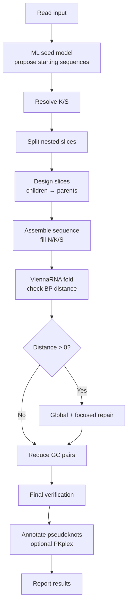
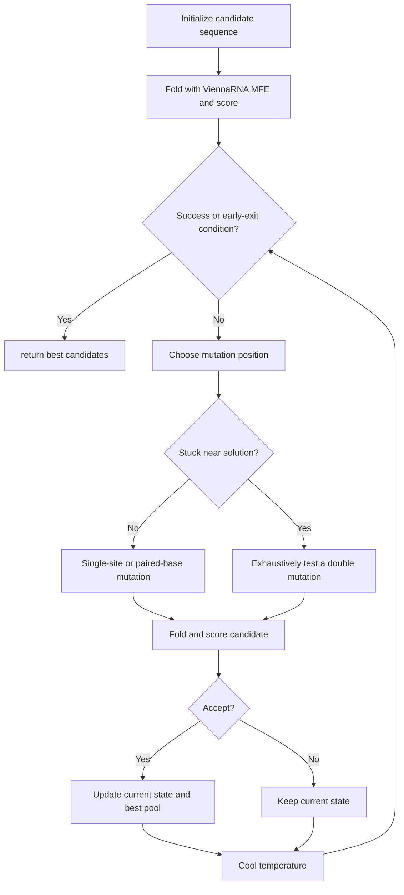

## Experimental pre-release

This release adds a neural-network seed model and introduces parallel
focused repair based on the complete candidate pool from the preceding
multi-start repair stage.

### Main changes
- **New:** a constraint-aware neural network (transformer) proposes the
  initial seed sequences that the design procedure starts from. It can be
  trained on synthetic data and then improved from AROS's own designs
  (see [Machine-learning seed model](#machine-learning-seed-model)).
- Preserves candidates produced by the first focused repair.
- Runs the next focused repair from each retained candidate in parallel.
- Improves scoring and avoids unnecessary partition-function calculations.
- Adds stagnation handling for difficult repair trajectories.

This is a pre-release intended for testing. The previous stable release
remains the recommended version for normal use.


# AROS (Automated RNA Optimization By Slicing)

A Rust-based RNA sequence design tool built on the
[ViennaRNA](https://www.tbi.univie.ac.at/RNA/) library. Given a target
RNA secondary structure in dot-bracket notation, it searches for
sequences that fold into that structure. It uses ViennaRNA's
minimum-free-energy (MFE) folding to score candidates, runs several
rounds of a parallel multi-start hill-climbing design procedure, and
reports the best results. Starting sequences can optionally be proposed
by a small neural network (the **ML seed model**, written in Python and
PyTorch) that respects the nucleotide constraints you give it.

The program supports two sequence-generation modes:

1.  **Generate from ambiguous nucleotides** Generate sequences from an
    input sequence containing ambiguous RNA nucleotide symbols such as:

    -   `N` --- any nucleotide
    -   `K` --- `G` or `U`
    -   `S` --- `G` or `C`

    The ML seed model additionally understands the other standard IUPAC
    codes (`W`, `R`, `Y`, `M`, `B`, `D`, `H`, `V`).

2.  **Generate from a preferred starting sequence** When
    `const RIBOSOMAL_RNA : bool = true;` is enabled in the program
    configuration, generation begins from the ribosomal large-subunit
    rRNA sequence, or any other query sequence of your choice.

    The output includes a percentage score indicating how much of the
    original sequence remains in the generated sequence. Note that with
    this method the program uses longer time to converge towards target
    structure, or might not quite reach it at all (`bp_distance > 0`)

Other features:

-   Neural-network seed generation that satisfies your constraints by
    construction, and can be retrained on AROS's own results.
-   Configurable number of design rounds and parallel runs.
-   Optional scrollable in-terminal viewer for the results, so you don't
    have to open multiple output files to find a candidate.
-   Cross-platform: macOS (Intel and Apple Silicon), Linux, and Windows.

> **Note:** The `Python/` folder and its legacy Python script are not used
> by the current program. The ML seed scripts (`ML_MODEL.py`,
> `RUN_MODEL.py`, `train_model.py`) are separate and **are** used; see
> below.

## How it works

AROS designs sequences in four stages, preceded by an optional seeding
step. It splits the target into nested **slices**, designs each slice
with a hill-climbing search, repairs the assembled sequence globally, and
finally verifies and annotates pseudoknots.



### 0. Seeding with the ML model

Instead of starting from purely random fill-ins for `N`/`K`/`S` positions,
the design can start from seeds sampled from a trained neural network.
The model sees the target structure and your constraint string and
proposes full sequences whose base pairs are all valid and whose fixed
bases are untouched. These seeds give the hill-climbing search a better
starting point than random nucleotides. The model is described in detail
in [Machine-learning seed model](#machine-learning-seed-model).

### 1. Slicing the target

ViennaRNA's MFE algorithm (Zuker) runs in O(n³), so folding one long
sequence over and over is slow. Instead the target is broken into
smaller problems, **slices**, which are solved in parallel:


The `slices` value in the output is the number of slices the target was
split into.

### 2. Designing a slice

Each slice is passed to `multi_start_hill_climb_design()`, which runs
several independent `hill_climb_design()` searches in parallel (5 by
default). Each search works like this:





For slices, the search exits early when the base-pair distance falls
below a threshold that depends on the number of designable positions
and the partition function shows that the remaining
nucleotides are only weakly paired (always below 0.7).

#### Scoring a candidate
 
1.  **Strip pseudoknots.** ViennaRNA does not fold pseudoknots directly,
    so `[` and `]` in the target are converted to dots.
2.  **Mask fixed bases.** Fixed bases at positions that are unpaired in
    the target are left untouched.
3.  **Fold.** ViennaRNA computes the MFE structure.
4.  **Measure the distance** to the pseudoknot-stripped target with
    `vrna_bp_distance()`:
``` math
D_{\text{VRNA}} = \text{BPDistance}(S_{\text{MFE}},\, S_{\text{target without PK}})
```
 
Pseudoknot pairs are stored in a pair map, mutated together with the
sequence, and scored with a penalty for each invalid pair and
wobble-baspair:
 
``` math
D_{\text{candidate}} = D_{\text{VRNA}} + 2 \times N_{\text{invalid PK pairs}}
```
 
A score of `0` means the candidate folds exactly into the target.
 
#### Energy gap
 
Two candidates can tie on $D_{\text{candidate}}$ while differing in how
*thermodynamically favorable* the target fold actually is for each of
them — one sequence might only be reachable within that base-pair
distance, while another actually folds into it as its true minimum-free-
energy structure. `energy_of_target_structure` measures this directly:
 
``` math
\Delta E = \max\!\Big(0,\; E(S_{\text{target}} \mid \text{seq}) - E_{\text{MFE}}(\text{seq})\Big)
```
 
- $E(S_{\text{target}} \mid \text{seq})$ is the free energy of folding the candidate sequence specifically into the *target* structure (via `vrna_eval_structure`), whether or not that's the sequence's actual MFE fold.
- $E_{\text{MFE}}(\text{seq})$ is the free energy of the sequence's true MFE structure, from `vrna_mfe`.
- The gap is clamped at `0`, since the target structure can never be more stable than the true MFE structure.
A gap of `0` means the target structure *is* the sequence's MFE fold — the strongest possible outcome. A larger gap means the target is only a local, less-favored fold, making it more likely the sequence "escapes" to a different structure in practice. `current_energy_gap` is recomputed every time a candidate is accepted, so it always reflects the live current state rather than a stale prior candidate.
 
#### Accepting candidates
 
A candidate replaces the current one if its distance is lower, or if the
distance is equal and its **energy gap** $\Delta E$ is smaller (same
structure, more thermodynamically stable). Even on a tied distance with
a larger gap, the candidate can still be accepted probabilistically:
 
``` math
P(\text{accept tied, worse gap}) = \exp\!\left(-\frac{\Delta E_{\text{candidate}} - \Delta E_{\text{current}}}{T}\right)
```
 
A worse candidate is still accepted with probability
 
``` math
P(\text{accept worse}) = \exp\!\left(-\frac{D_{\text{candidate}} - D_{\text{current}}}{T}\right)
```
 
where the temperature $T$ decreases linearly over time, so the search
shifts from exploring to refining. If progress stalls once $T$ reaches
its minimum of `0.05`, it is reset to `1`. The cooling rate is set from
the number of designable positions.


### 3. Repairing the full sequence

**Global repair.** The best slice designs are assembled into the full
sequence and the base-pair distance is recomputed. The remaining
mismatched positions are then repaired in parallel for at most 800
iterations, where the iteration count scales with the distance:

``` math
\text{repair steps} = \min\left(800,\; \frac{d_{\text{bp}}}{0.008}\right)
```

where $d_{\text{bp}}$ is the base-pair distance of the assembled
sequence.

It stops when the iteration limit is reached, or when the distance is
below a precomputed threshold and the partition function shows low pair
probabilities (about 0.5). A repaired sequence replaces the original
only if it improves on it.

**The final focused repairs.** If the distance is still not below 2--3,
`multi_start_hill_climb_design()` runs twice more on the remaining
mismatches. This time all paired nucleotides start as G--C pairs to
favour strong stems. The exit criteria are stricter on pair
probabilities (0.1) and looser on distance (3--5), and the iteration
count is clamped between 1 and 100.

**GC-cleanup**. After the final repairs all GC-pairs in the
designable positions are attempted substituted for AU-pairs while
keeping the base-pair distance unchanged, or reduced. This is to reduce
the inflated GC-content which usually ends up at around 80% before this
step.

### 4. Pseudoknot verification and annotation

The ViennaRNA MFE structure contains no pseudoknots, so they are
reinstated at the target's pseudoknot positions wherever the designed
bases can form valid pairs. This should always be the case, since
pseudoknot positions are treated as paired during design. The program
then runs ViennaRNA's PKplex as a final, separate pseudoknot check.

The reported **MFE structure with PK** is therefore the ViennaRNA MFE
structure for the ordinary nested pairs, plus the target's pseudoknot
brackets where the sequence supports valid base pairs. It is **not** a
full thermodynamic pseudoknot MFE prediction. PKplex output is the
separate pseudoknot-oriented check.

## Machine-learning seed model

The seed model is a small transformer that learns, from RNA structures,
which nucleotides tend to go where. Given a target structure and a
constraint string, it samples full candidate sequences that AROS then
uses as starting points. It does **not** replace the ViennaRNA-based
design and repair: the seeds are only a head start, and every candidate is
still folded and scored by ViennaRNA as described above.

The model code lives in three Python files:

| File | Purpose |
|------|---------|
| `ML_MODEL.py` | The model, constraint handling, data generation, and training/update routines |
| `RUN_MODEL.py` | **Inference only.** Reads an AROS input file, samples seeds, writes a seed file |
| `train_model.py` | Training driver: `pretrain` on synthetic data and `update` from AROS's own designs |

### Requirements

-   Python 3.12 (the scripts use a `python3.12` shebang)
-   `pip install torch ViennaRNA` (the `RNA` Python module is used only
    to label training data; PyTorch runs on CPU by default)

### What the model does

**Inputs per target:** a dot-bracket structure and a constraint string of
the same length, using the same alphabet as the AROS input file:

| Symbol | Meaning |
|--------|---------|
| `A` `C` `G` `U` | Known base, copied through unchanged |
| `N` | Any base |
| `S` | `G` or `C` (on both sides of a pair: a GC/CG pair) |
| `K` | `G` or `U` (on both sides of a pair: a GU/UG wobble pair) |
| `W` `R` `Y` `M` `B` `D` `H` `V` | Other IUPAC ambiguity codes |

**Architecture.** Each position is described by its structure symbol
(`.`, `(`, `)`), its loop context (external, hairpin, bulge/interior,
multiloop, stem, stem end), its constraint code and its position. A
4-layer transformer encoder (128 dimensions, 4 heads) processes these,
with attention biased towards each base's pairing partner. Two output
heads then predict:

-   a nucleotide for every unpaired position, and
-   one of the six pair types (`AU`, `UA`, `GC`, `CG`, `GU`, `UG`) for
    every base pair, so both sides of a pair are sampled **jointly**.

**Constraints are enforced by masking, not by hoping.** Before sampling,
every option that violates the constraint string, or that is not a valid
pair type for the two constraint characters, is masked out. Every sampled
seed therefore satisfies your constraints, and every base pair in it is a
valid pair. If a pair's two constraint characters allow no valid pair at
all (for example `A`–`A`), that target is rejected as infeasible.

### Generating seeds

``` bash
python3.12 RUN_MODEL.py --input misc/input_1.txt --output seeds.txt \
    --n 16 --temp 1.0
```

| Option | Default | Meaning |
|--------|---------|---------|
| `--input` | required | AROS input file (`Sequence :` / `Structure :` blocks; any number of targets) |
| `--output` | required | Seed file to write |
| `--n` | `16` | Seeds sampled per target |
| `--temp` | `1.0` | Sampling temperature. Higher gives more diverse seeds, lower gives seeds closer to the model's top choice |
| `--ckpt` | `checkpoints/best.pt` | Model checkpoint to use |
| `--seed` | none | Set for reproducible seeds |

The output contains `n` blocks per target in the same format as the
input:

```
Sequence : GCGCAAAAGCGCAA...
Structure : ((((....))))..
```

Exit codes (useful when called from another program): `0` success, `1`
some targets failed but the others were still written, `2` fatal (no
checkpoint, no targets parsed, or nothing written). Warnings and errors
go to stderr; the summary line goes to stdout.

**Input handling in `RUN_MODEL.py`:**

-   Pseudoknot brackets `[` `]` are converted to dots, and `{` `}` are
    converted to `(` `)`, before the model sees the structure. The model
    therefore treats pseudoknot positions as unpaired and does not
    design them as pairs; the pseudoknot handling stays with the main
    AROS procedure (stage 4).
-   Placeholder letters other than `A C G U N K S` are supported. An
    uppercase placeholder (e.g. `X`) is replaced by a random sequence of
    the length of its longest run, identically everywhere it appears. A
    lowercase placeholder (e.g. `x`) is replaced by the reverse
    complement of that same sequence, which makes it easy to specify
    stems that must pair with each other.
-   `T` is accepted in place of `U`.

### Training the model

You need a checkpoint at `checkpoints/best.pt` before seeds can be
generated.

**1. Pre-train on synthetic data**

``` bash
python3.12 train_model.py pretrain --n 20000 --epochs 30
```

Random sequences (80--400 nt, varying GC content) are folded with
ViennaRNA, and the model learns to reproduce the sequence from its own
MFE structure. Constraints are derived at random from each example every
time it is batched, so the model learns to work with anything from fully
unconstrained to heavily constrained input. Training uses a validation
set and early stopping (`--patience`, default 4, active after epoch 5).
It writes `checkpoints/best.pt` and `checkpoints/buffer.jsonl` (the
replay data for later rounds). Because the constraints are re-randomised
on each pass, validation loss is somewhat noisy.

Other options: `--n_val` (validation examples, default 1000) and
`--seed` (default 0).

**2. Improve from AROS's own designs (self-training)**

``` bash
python3.12 train_model.py update --epochs 2
```

AROS writes the designs it produced to
`Training_data/training_data_positive.txt` and
`Training_data/training_data_negative.txt` (same `Sequence` / `Structure`
format). `update` then performs one self-training round:

-   **Hindsight relabeling.** Every design, including failed ones, is
    paired with the structure it *actually folds into*, so failures still
    become valid training examples. The original constraint string is kept
    only if the design really solved its target; otherwise a random
    constraint is derived.
-   **Replay buffer with fresh synthetic data.** 30% fresh synthetic
    examples (relative to buffer size) are mixed in each round to guard
    against drift and collapse.
-   **Versioned checkpoints.** The model is saved as
    `checkpoints/round_XX.pt` (so a bad round can be rolled back) as well
    as `checkpoints/best.pt`.
-   **Archiving.** The consumed Rust files are moved to
    `Training_data/archive/` with a timestamp, so the next round only
    sees new designs.

If `best.pt` is missing, `update` stops and asks you to run `pretrain`
first. If there are no new designs, it does nothing.

### Limitations

-   Targets longer than **512 nucleotides** exceed the model's position
    embedding (`maxlen=512`) and cannot be seeded without retraining a
    larger model. Pre-training data covers 80--400 nt, so structures much
    outside that range are less well supported.
-   Pre-training uses structures that are MFE folds of random sequences,
    so unusual target structures may be out of distribution. Self-training
    on AROS's own designs is meant to close that gap over time.
-   Pseudoknot pairs are not modelled (see above).
-   Seeds are a starting point only; a seed that does not fold correctly
    is expected and is improved by the normal AROS repair stages.

### Supported platforms

`setup.sh` detects your OS/CPU and stages the correct prebuilt (or
freshly built) native libraries automatically.

| Platform | Architecture                              | Status                                                       |
|------------------------|------------------------|------------------------|
| macOS    | Intel (`x86_64-apple-darwin`)             | Tested in GitHub Actions CI                                  |
| macOS    | Apple Silicon (`aarch64-apple-darwin`)    | Tested in GitHub Actions CI                                  |
| Linux    | `x86_64-unknown-linux-gnu`                | Tested in GitHub Actions CI                                  |
| Linux    | `aarch64-unknown-linux-gnu`               | Tested in GitHub Actions CI when ARM64 runners are available |
| Windows  | `x86_64-pc-windows-gnu` via MSYS2 MinGW64 | Tested in GitHub Actions CI                                  |
| WSL2     | Treated as Linux                          | Supported by `setup.sh`                                      |

On macOS and Linux, ViennaRNA is built from source by `setup.sh` if a
prebuilt archive is not already present in `vendor/`; GSL, MPFR, and GMP
are pulled from your package manager (Homebrew or your Linux
distribution's package manager). On Windows, all native libraries
(including ViennaRNA) are built from source using MSYS2 MinGW64.

The ML seed model requires a separate Python 3.12 environment with
PyTorch and the ViennaRNA Python bindings (see
[Machine-learning seed model](#machine-learning-seed-model)).

## Installation {#installation}

### Requirements

#### All platforms

-   Git and **Git LFS** (see [Git LFS](#git-lfs-required) below)
-   At least 2--3 GB of free disk space for Rust, compiler toolchains,
    downloaded packages, and native-library builds
-   An Internet connection for the first setup run
-   Python 3.12 with `torch` and `ViennaRNA` (`pip install torch ViennaRNA`)
    if you want to use the ML seed model

#### macOS

-   Intel or Apple Silicon Mac
-   Xcode Command Line Tools (`xcode-select --install`)
-   Homebrew (installed automatically by `setup.sh` if missing)

> **Intel Macs:** Homebrew no longer provides prebuilt bottles for
> Intel, so `brew install` may compile dependencies (for example LLVM)
> from source, which can take a very long time. If a build seems idle,
> it is usually still compiling.

#### Linux

-   `x86_64` or `arm64` Linux
-   Rust toolchain
-   Clang and `libclang` development files, required by Rust `bindgen`
-   A supported package manager: `apt`, `dnf`, `yum`, `pacman`, or
    `zypper`

For Ubuntu or Debian-based distributions:

``` bash
sudo apt-get update
sudo apt-get install -y \
  build-essential \
  clang \
  libclang-dev \
  pkg-config \
  git \
  git-lfs \
  curl
```

#### Windows

-   Windows 10 or Windows 11 on `x86_64`
-   [MSYS2](https://www.msys2.org/) installed
-   The build must be run from the **MSYS2 MinGW x64** terminal
    specifically. Do **not** use PowerShell, Command Prompt, Git Bash,
    WSL, the plain MSYS2 shell, UCRT64, or CLANG64.
-   Internet access for the initial `pacman`, Rust, and ViennaRNA setup

`setup.sh` configures the `stable-x86_64-pc-windows-gnu` Rust toolchain
and installs the required MinGW64 packages. The first Windows setup may
take several minutes because it downloads compilers, LLVM/Clang,
autotools, GMP, MPFR, GSL, and builds ViennaRNA.

### Git LFS (required) {#git-lfs-required}

The prebuilt native libraries in `vendor/` are large binaries and are
stored with [Git LFS](https://git-lfs.com). Install Git LFS **before
cloning**, otherwise you will get small pointer files instead of the
real libraries and the build will fail.

``` bash
# macOS (Apple Silicon)
brew install git-lfs

# Ubuntu / Debian
sudo apt-get install git-lfs

# Windows (MSYS2 MinGW x64)
pacman -S --needed git-lfs

# Once per machine:
git lfs install
```

If you already cloned without Git LFS, run this inside the repository:

``` bash
git lfs pull
```

### Quick start: macOS

Clone the repository and run the setup script:

``` bash
git clone https://gitlab.igem.org/2026/software/aarhus-university/AROS-rna-sequence-generator.git
cd AROS-rna-sequence-generator

# Run setup in the current shell so Cargo and native-library environment
# variables remain available immediately afterward.
source ./setup.sh
```

The setup script installs required tools when needed and builds the
project. This works the same way on Intel and Apple Silicon Macs,
because `setup.sh` detects your CPU architecture and targets it
automatically.

Then run the program (`--release` is faster):

``` bash
cargo run --release
```

If Rust was not installed automatically, install it with:

``` bash
curl --proto '=https' --tlsv1.2 -sSf https://sh.rustup.rs | sh
source "$HOME/.cargo/env"
```

### Quick start: Linux

Install the system requirements shown above, then clone the repository:

``` bash
git clone https://gitlab.igem.org/2026/software/aarhus-university/AROS-rna-sequence-generator.git
cd AROS-rna-sequence-generator

# `source` keeps PATH and other setup environment variables in this shell.
source ./setup.sh

cargo run --release
```

This works on both `x86_64` and `arm64` Linux; `setup.sh` detects your
architecture and builds ViennaRNA from source if a prebuilt archive
isn't already vendored.

### Quick start: Windows (MSYS2 MinGW64)

1.  Install [MSYS2](https://www.msys2.org/).

2.  Open the **"MSYS2 MinGW x64"** terminal from the Start menu (this
    specific shell is required). \> This specific terminal is required.
    Do not use PowerShell, Command Prompt, \> Git Bash, WSL, the plain
    MSYS2 shell, UCRT64, or CLANG64.

3.  Install Git LFS if it is not already available:

    ``` bash
    pacman -S --needed git-lfs
    git lfs install
    ```

4.  Clone the repository and run the setup script:

    ``` bash
    git clone https://gitlab.igem.org/2026/software/aarhus-university/AROS-rna-sequence-generator.git
    cd AROS-rna-sequence-generator
    source ./setup.sh
    ```

    This installs the MinGW toolchain, GMP, MPFR, and GSL via `pacman`,
    builds ViennaRNA from source, and adds the `x86_64-pc-windows-gnu`
    Rust target.

5.  Run the program, targeting the GNU toolchain:

    ``` bash
    cargo run --release --target x86_64-pc-windows-gnu
    ```

> Native Windows support currently covers `x86_64` only.

## Troubleshooting

| Problem                                                                              | Fix                                                                                                                                                   |
|------------------------------------|------------------------------------|
| Build fails with tiny "pointer" files in `vendor/` or linker errors about `libRNA.a` | Git LFS did not download the vendored files. Run `git lfs install && git lfs pull` from the repository root.                                          |
| `setup.sh` fails on Windows                                                          | Open **MSYS2 MinGW x64** specifically. PowerShell, CMD, Git Bash, WSL, plain MSYS2, UCRT64, and CLANG64 are unsupported for the native Windows build. |
| `cargo: command not found` immediately after setup                                   | Run `source ./setup.sh`, not `./setup.sh`. Alternatively, close and reopen the terminal after Rust installation.                                      |
| `cargo: command not found` on Windows after reopening MSYS2                          | Confirm that Rust is installed, then run `source ./setup.sh` from MSYS2 MinGW x64.                                                                    |
| `bindgen` cannot find `libclang`                                                     | Run `source ./setup.sh` again. On Linux, ensure `clang` and `libclang-dev` are installed.                                                             |
| Setup appears frozen during Windows installation                                     | The first run may download/install a large MinGW64 toolchain and build ViennaRNA. Let `pacman` and `make` finish.                                     |
| Setup seems frozen on an Intel Mac                                                   | Homebrew may be compiling dependencies such as LLVM from source. This can take a long time.                                                           |
| Program uses all CPU cores                                                           | Lower the number of parallel runs at the second prompt.                                                                                               |
| `ERROR: checkpoint not found` from `RUN_MODEL.py`                                    | No trained model exists yet. Run `python3.12 train_model.py pretrain` to create `checkpoints/best.pt`.                                                |
| `ModuleNotFoundError: torch` or `RNA`                                                | Install the Python dependencies: `pip install torch ViennaRNA`, using Python 3.12.                                                                    |
| `WARNING: skipped target (...)` from `RUN_MODEL.py`                                  | The constraint string and structure differ in length, contain unsupported characters, or contain a base pair whose constraints allow no valid pair.   |
| `no new designs from Rust, nothing to do` from `train_model.py update`               | `Training_data/training_data_positive.txt` and `..._negative.txt` are missing or empty. Run AROS first so it can write them.                          |

## Usage

Run this command from the repository root, the directory containing
`Cargo.toml`:

``` bash
cargo run
```

For an optimized release build:

``` bash
cargo run --release
```

On Windows, pass `--target x86_64-pc-windows-gnu` to both commands.

When the program starts you will be asked:

1.  **How many rounds to run.** Type a number and press Enter. The
    default is three rounds.
2.  **How many runs `multi_start_hill_climb_design()` should execute in
    parallel.** The default is five. The more parallel runs you choose,
    the more CPU cores are used, so choose with consideration.

Once the run has finished you can choose to view the results as a
scrollable element in the terminal (y/n). This is useful for comparing
candidates without opening multiple output files.

To use ML-generated seeds, make sure a trained checkpoint exists first
(see [Training the model](#training-the-model)).

### Input and output files

Input files are located in:

```         
misc/
```

They are named with the `input_` prefix. Each input file must contain:

-   An RNA sequence
-   A matching RNA secondary structure in dot-bracket notation

For example:

```         
Sequence:  GGGAAACCC
Structure: (((...)))
```

The sequence and structure must have the same length.

Generated output files are written to:

```         
misc/output/
```

Seed files from the ML model (`RUN_MODEL.py`) use the same
`Sequence` / `Structure` block format as the input files. Designs used to
retrain the model are written to `Training_data/`.

## Example

**Input**: a file in `misc/` with the `input_` prefix, for example
`misc/input_1.txt`:

```         
Sequence: NNNNNNNNNNNNNNNNNNNNNNNNNNNNNNNNNNNNNNNNNUUCGNNNNNNNNNCCGUGCGAGACGGUCGGGUCCAUAGCUAAUUCGUUAGUUAUGUCGAGUAGAGUGUGGGCUCGUACGGGGUGGUGAAGCCUCCACGCCACCNNNNNNNNNNNNNNNNNNNNNNCGACUGAAGGAGGCACGGUCGGCCAUCCGUUUCGACGGGUGGCNNNNNNNNNN
Structure: (((((((((((((((((((((((((((((((((((((((((....)))))))))(((((((((.(.((...((((((((((((....)))))))))..)).)...))...).)))))))))(((((((..[[[[[[.)))))))))))))))))))))))))))))((((((..]]]]]].))))))(((((((((....)))))))))))))))))))
```

The sequence and structure must be the same length.

**Run**:

```         
$ cargo run
    Finished `dev` profile [unoptimized + debuginfo] target(s) in 0.23s
     Running `target/debug/AROS`
========================================
RNA design configuration
Press Enter to accept a default value.
========================================
How many complete runs should be performed? [3]: 10
How many hill-climbing starts per run? [5]: 8
```

**Output**: written to `misc/output/`, and viewable in the terminal when
asked (y/n):

run 4 was the best of the 10:

```         
==== FINAL (run 4) ====
sequence      : CUAUUACGCCCAACAUGAAACGAACUGGAAGCCACACCCGGUUCGCCGGGUGUGCCGUGCGAGACGGCCGGGUCCAUAGCUAAUUCGUUAGUUAUGUCGAGCAGAGUGUGGGCUCGUACGGGGUGGUGAAGCCUCCACGCCACCGCUUCCAGUUCGUUUCAUGUUGCGACUGAAGGAGGCACGGUCGGCCAUCCGUUUCGACGGGUGGCGGCGUAAUAG
target        : (((((((((((((((((((((((((((((((((((((((((....)))))))))(((((((((.(.((...((((((((((((....)))))))))..)).)...))...).)))))))))(((((((..[[[[[[.)))))))))))))))))))))))))))))((((((..]]]]]].))))))(((((((((....)))))))))))))))))))
mfe structure : (((((((((((((((((((((((((((((((((((((((....)))))))))(((((((((.(.((...((((((((((((....)))))))))..)).)...))...).)))))))))(((((((..[[[[[[.)))))))))))))))))))))))))))))((((((..]]]]]].))))))(((((((((....)))))))))))))))))))
bp_distance   : 0
mfe           : -110.40
slices        : 12
Ribosomal RNA used: false
GC Content: 75.58%
```

**Reading the result**

| Field                | Meaning                                                                                     |
|------------------------------------|------------------------------------|
| `sequence`           | The generated RNA sequence                                                                  |
| `target`             | The structure you asked for (dot-bracket)                                                   |
| `mfe structure`      | The structure ViennaRNA predicts for the sequence                                           |
| `bp_distance`        | Base-pair distance between target and predicted structure. `0` means an exact match         |
| `mfe`                | Minimum free energy of the predicted structure in kcal/mol. More negative means more stable |
| `slices`             | Number of substructures the target was split into during design                             |
| `Ribosomal RNA used` | Which mode was run. If `true`, a sequence-identity percentage is also shown                 |
| `GC Content`         | Fraction of G and C. High GC generally stabilises stems and hairpins                        |

**Using a starting sequence**: to begin from a query sequence instead of
ambiguous nucleotides, set `const RIBOSOMAL_RNA: bool = true;` in
`src/main.rs` and put your query sequence in
`const RIBOSOME_SEQUENCE: &str = "...";`. Then rebuild and run with
`cargo run --release` (or `cargo run` for a debug build, which is
slower).

**Using ML seeds**: to preview what the model proposes for the same
input, run

``` bash
python3.12 RUN_MODEL.py --input misc/input_1.txt --output seeds.txt --n 8
```

and inspect `seeds.txt`. Each block is one candidate starting sequence for
the target, with every fixed base preserved and every base pair valid.

## Contributing

We welcome contributions. To get started:

1.  Install the requirements for your platform and Git LFS (see
    [Installation](#installation)).
2.  Clone the repository and run `source ./setup.sh` from a supported
    shell (see the quick starts above).
3.  Create a branch, make your changes, and open a merge request against
    `main`.

Useful commands:

``` bash
cargo build            # debug build
cargo run --release    # optimized build and run
```

For windows:

``` bash
cargo build --target x86_64-pc-windows-gnu
cargo run --release --target x86_64-pc-windows-gnu
```

### Native dependencies

The project uses the following native libraries:

-   **ViennaRNA** --- RNA secondary-structure prediction and MFE folding
-   **GMP** --- GNU Multiple Precision Arithmetic Library
-   **MPFR** --- multiple-precision floating-point arithmetic
-   **GSL** --- GNU Scientific Library

On macOS, Linux, and Windows, `setup.sh` builds and/or copies these into
a target-specific directory under `vendor/RNAlib/prebuilt/`, for
example:

```         
vendor/RNAlib/prebuilt/x86_64-unknown-linux-gnu/
vendor/RNAlib/prebuilt/aarch64-apple-darwin/
vendor/RNAlib/prebuilt/x86_64-pc-windows-gnu/
```

The Rust build script (`build.rs`) selects the correct prebuilt library
directory for the current target platform and expects the ViennaRNA
headers in `vendor/RNAlib/include/ViennaRNA`.

### Python dependencies (ML seed model)

-   **PyTorch** (`torch`) --- the transformer model and training
-   **ViennaRNA Python bindings** (`ViennaRNA`, imported as `RNA`) ---
    folding used to label training data

### Continuous integration

The GitHub mirror runs `.github/workflows/test-all-platforms.yml`, which
tests:

-   macOS Intel: `x86_64-apple-darwin`
-   macOS Apple Silicon: `aarch64-apple-darwin`
-   Linux x86_64: `x86_64-unknown-linux-gnu`
-   Linux ARM64: `aarch64-unknown-linux-gnu`, when GitHub-hosted ARM64
    runners are available
-   Windows MSYS2 MinGW64: `x86_64-pc-windows-gnu`

The Windows CI job uses MSYS2 MinGW64, runs `source ./setup.sh`, builds
ViennaRNA and native dependencies, and runs both `cargo test` and
`cargo build` for the GNU Windows target.

### Project structure

```         
AROS-rna-sequence-generator/
├── Cargo.toml
├── Cargo.lock
├── build.rs
├── config.toml
├── setup.sh
├── wrapper.h
├── src/
│   └── main.rs
├── ML_MODEL.py                     # seed model, constraints, training routines
├── RUN_MODEL.py                    # inference: input file -> seed file
├── train_model.py                  # pretrain / update driver
├── checkpoints/                    # created by train_model.py
│   ├── best.pt                     # model used for seed generation
│   ├── round_XX.pt                 # versioned self-training rounds
│   └── buffer.jsonl                # replay data for update rounds
├── Training_data/                  # designs written by AROS for retraining
│   ├── training_data_positive.txt
│   ├── training_data_negative.txt
│   └── archive/                    # consumed files, timestamped
├── misc/
│   ├── input_*.txt
│   └── output/
├── Python/                         # legacy, unused
├── vendor/
│   └── RNAlib/
│       ├── include/
│       │   └── ViennaRNA/          # ViennaRNA C headers
│       └── prebuilt/               # stored with Git LFS
│           ├── x86_64-apple-darwin/
│           ├── aarch64-apple-darwin/
│           ├── x86_64-unknown-linux-gnu/
│           ├── aarch64-unknown-linux-gnu/
│           └── x86_64-pc-windows-gnu/
│               ├── libRNA.a
│               ├── libgmp.a
│               ├── libmpfr.a
│               ├── libgsl.a
│               └── libgslcblas.a
└── .github/
    └── workflows/
        ├── build-linux-viennarna.yml
        └── test-all-platforms.yml
```

## Authors and acknowledgment

Developed by Henrik Mengkrogen

contributor(s): Henrik Mengkrogen

This project builds on the [ViennaRNA
Package](https://www.tbi.univie.ac.at/RNA/), and on the GMP, MPFR, and
GSL libraries. The ML seed model is built with
[PyTorch](https://pytorch.org/).

## License

This repository is licensed under the [Apache License 2.0](LICENSE) ---
a permissive open-source license recommended for software (Creative
Commons licenses are *not* intended for source code). You are free to
use, modify, and distribute this software, provided you keep the license
and attribution notices. If you prefer different terms for your own
tool, you may replace this license, but it must remain an [OSI-approved
open-source license](https://opensource.org/licenses).

## Citation

If you use this tool, please cite the iGEM Aarhus University 2026 team
and ViennaRNA:

Lorenz, R. et al. (2011). ViennaRNA Package 2.0. *Algorithms for
Molecular Biology*, 6:26.